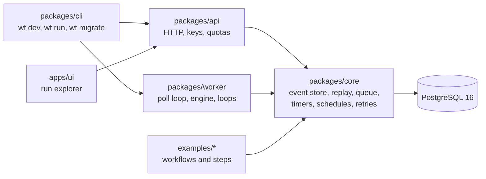
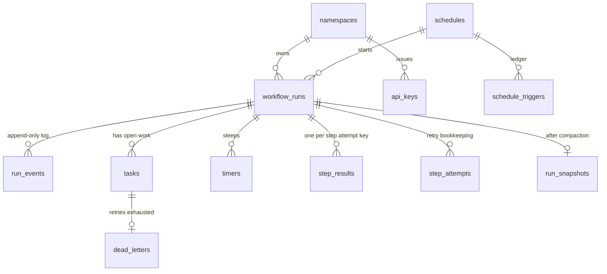
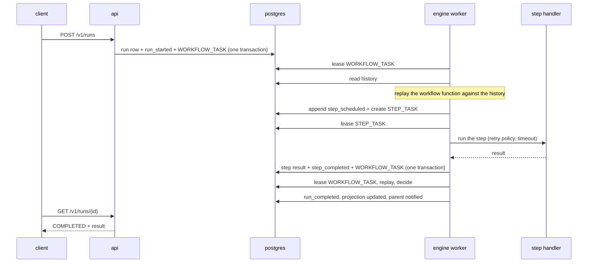

# Architecture

The engine is a set of small libraries and processes around one PostgreSQL database. Postgres is the only stateful part: the event log, the task queue, the timers and the schedules all live in it. Every other process can be stopped and replaced at any time.

## The packages

| Package           | What lives there                                                                                                                                                                                                     |
| ----------------- | -------------------------------------------------------------------------------------------------------------------------------------------------------------------------------------------------------------------- |
| `packages/core`   | The workflow DSL (`defineWorkflow`, `defineStep`, `ctx`), the event store, the decision loop that replays history, the task queue, timers, schedules, retries, quotas, the janitor, metrics and tracing.             |
| `packages/worker` | A worker (poll loop, lease heartbeat, graceful shutdown), the engine runtime `startEngine` that consumes workflow and step tasks, and the timer, schedule and janitor loops. Also the chaos and benchmark harnesses. |
| `packages/api`    | A `node:http` layer over one route table: runs, signals, cancellation, history, dead letters, the run stream, health, metrics and the generated OpenAPI document.                                                    |
| `apps/ui`         | A run explorer written as typed browser modules and served from the API's origin.                                                                                                                                    |
| `packages/cli`    | `wf`: `dev`, `worker`, `migrate`, `run ...` and `example`.                                                                                                                                                           |
| `examples`        | `hello`, `payment-saga` and `etl-pipeline`.                                                                                                                                                                          |

## The data model

- `run_events` is the source of truth. A row is `(run_id, sequence_number, event_type, payload)` and the pair `(run_id, sequence_number)` is unique, which is what makes appends safe under concurrency.
- `workflow_runs` is a projection: the status, the result and the timestamps are a pure fold over the events and can be rebuilt from them.
- `tasks` is the queue. A task is `PENDING`, `LEASED`, `COMPLETED` or `QUARANTINED`. A lease has a token and an expiry.
- `step_results` and `workflow_task_results` are the idempotency ledgers: a result is written once per logical key, in the same transaction as the event it produces.
- `timers`, `schedules` and `schedule_triggers` make time durable: a timer fires from the database, never from process memory.

Schema changes are SQL migration pairs in `packages/core/migrations`, applied by `wf migrate` or `pnpm run migrate:up`.

## The life of a run

1. A client starts a run. The API writes the run row, the first event and a workflow task in one transaction.
2. A worker leases the workflow task, reads the history and runs the workflow function again from the top. Calls that already have a recorded result return it immediately. The first call without a result becomes a command: schedule a step, start a timer, start a child, complete the run.
3. The commands become events. A scheduled step becomes a step task.
4. A worker runs the step through the retry processor. The result, the event and the next workflow task are committed together.
5. The loop repeats until the workflow function returns or throws, which appends `run_completed` or `run_failed` and updates the projection.

A worker holds a task only while its lease is alive. It renews the lease on a heartbeat. If the worker dies, the lease expires and the janitor makes the task visible again; another worker takes it and the replay produces the same decision.

## Background loops

`startEngine` runs these next to the task consumer; each is safe to run in many processes at once.

| Loop     | Job                                                                                                         |
| -------- | ----------------------------------------------------------------------------------------------------------- |
| timer    | Fires due timers in order, one transaction per timer, and enqueues the workflow task that resumes the run.  |
| schedule | Starts runs for cron triggers that came due, including the ones missed while nothing was running.           |
| janitor  | Reclaims expired leases, quarantines poison tasks, recovers stalled runs by enqueueing a new workflow task. |

## Failure model

| Failure                              | What happens                                                                                                              |
| ------------------------------------ | ------------------------------------------------------------------------------------------------------------------------- |
| A worker is killed mid step          | The lease expires, the janitor reclaims the task, another worker runs the step again. Steps must be safe to run twice.    |
| A task is delivered twice            | Results are keyed; the second writer finds the first result and records nothing.                                          |
| Two writers extend one history       | The unique sequence number rejects one with a `ConcurrencyError`; its task is redelivered and replays the longer history. |
| The database connection drops        | The transaction rolls back as a whole; the task is redelivered.                                                           |
| The clock moves                      | Timers use a monotonic high water mark, so a clock stepped back never fires a timer early or twice.                       |
| The code changes under a running run | Replay compares each call with the recorded event and raises `NonDeterminismError`; see `docs/VERSIONING.md`.             |

`docs/CHAOS_REPORT.md` lists the six fault scenarios the test suite injects and the five invariants it checks after each.

## What the engine does not do

The engine is one Postgres deep. It does not shard the event log, run on a storage engine of its own, speak gRPC or span regions; `docs/OUT_OF_SCOPE.md` lists these and `docs/ROADMAP.md` says what comes next. Throughput on one node is in `docs/BENCHMARKS.md`.
